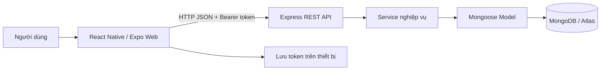
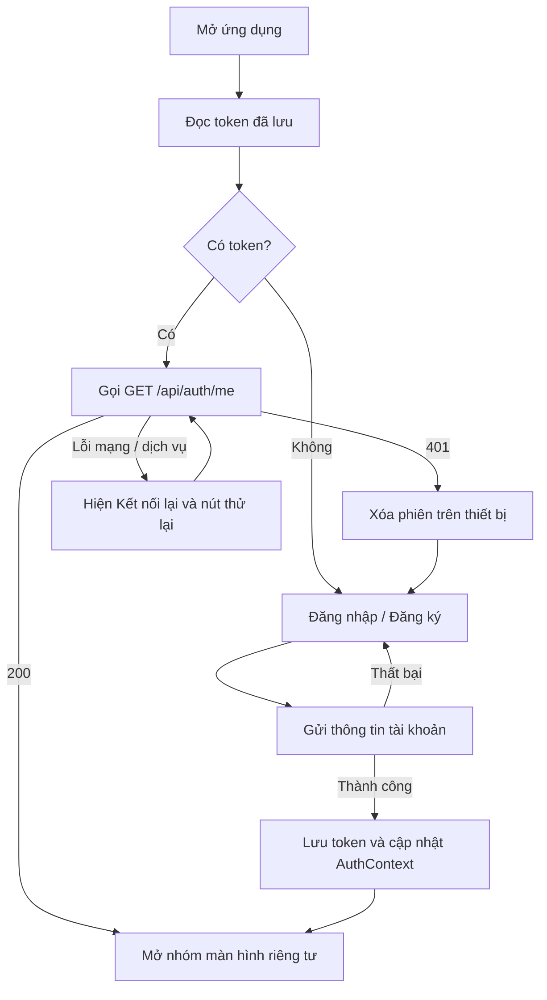
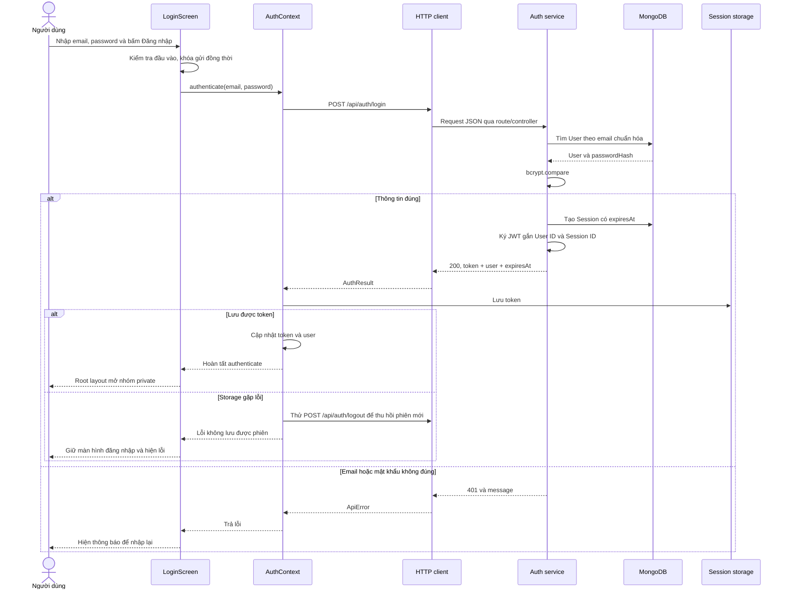
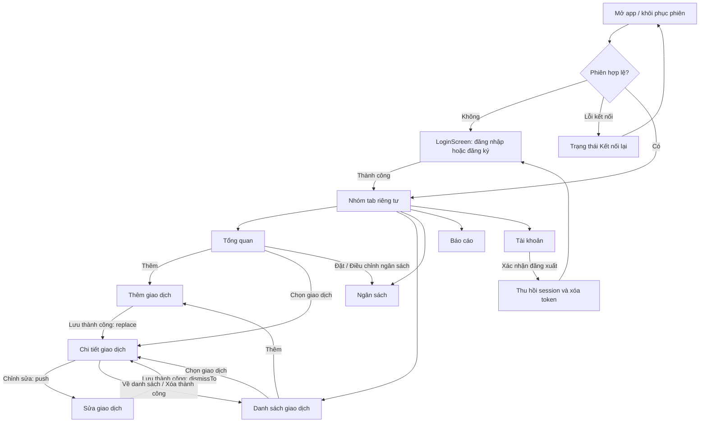
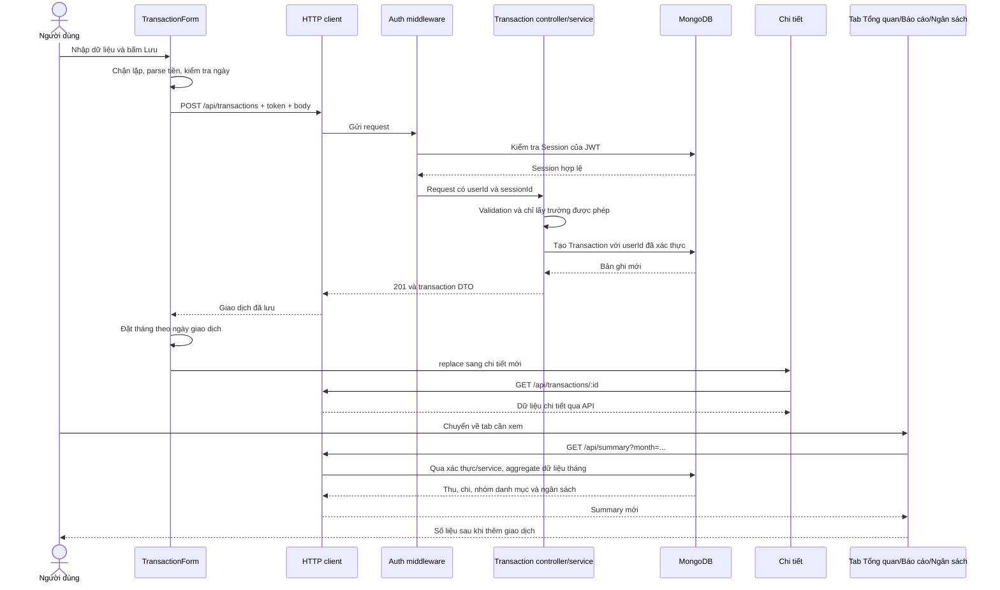

# Ví Sinh Viên — Hệ thống, luồng hoạt động và chức năng các màn hình

Tài liệu mô tả mã nguồn hiện tại của dự án, cập nhật ngày 28/10/2026. Có thể dùng để đọc hiểu source, viết báo cáo hoặc trình bày demo.

**Cách đọc:** mục 4 giải thích khởi động và phiên đăng nhập; mục 5 đi vào từng screen, sự kiện và nhánh xử lý; mục 6 nối các screen thành flow end-to-end và giải thích ảnh hưởng lên dữ liệu. Những tên như `busy`, `confirm`, `reload()` là state/hàm đang có trong mã nguồn.

| Nội dung cần tra cứu | Đi tới |
| --- | --- |
| Mở app, khôi phục phiên, trình tự đăng nhập | [Flow xác thực](#flow-xac-thuc) |
| Form tài khoản, state và các nút | [Đăng nhập / Đăng ký](#screen-dang-nhap) |
| Đọc số liệu và hành động nhanh | [Tổng quan](#screen-tong-quan) |
| Tìm kiếm, bộ lọc và phân trang | [Danh sách giao dịch](#screen-danh-sach) |
| Form, payload và trình tự lưu | [Thêm giao dịch](#screen-them) |
| Đọc ID, sửa, xác nhận xóa | [Chi tiết giao dịch](#screen-chi-tiet) |
| Tải form cũ, cập nhật, chuyển tháng | [Sửa giao dịch](#screen-sua) |
| Nhập hạn mức, upsert và mức sử dụng | [Ngân sách](#screen-ngan-sach) |
| Tổng hợp dữ liệu và tính biểu đồ | [Báo cáo](#screen-bao-cao) |
| Thông tin người dùng và các nhánh logout | [Tài khoản](#screen-tai-khoan) |
| Sơ đồ điều hướng, state dùng chung, sequence và ví dụ trước/sau | [Flow xuyên suốt](#flow-xuyen-suot) |

## 1. Mục đích và phạm vi

Ví Sinh Viên giúp người dùng ghi lại thu nhập, chi tiêu, đặt ngân sách và xem báo cáo theo tháng. Dữ liệu được lưu theo từng tài khoản.

| Chức năng | Hệ thống xử lý |
| --- | --- |
| Tài khoản | Đăng ký, đăng nhập, lưu/khôi phục phiên và đăng xuất |
| Giao dịch | Thêm, xem, sửa, xóa khoản thu hoặc khoản chi |
| Tra cứu | Tìm theo ghi chú/danh mục, lọc tháng/loại/danh mục, phân trang |
| Ngân sách | Đặt hoặc cập nhật hạn mức chi tiêu của từng tháng |
| Báo cáo | Tổng thu, tổng chi, chênh lệch, số giao dịch và phân bổ chi tiêu |
| Trạng thái giao diện | Đang tải, không có dữ liệu, lỗi, thử lại và xác nhận thao tác |

Ứng dụng là sổ ghi chép tài chính cá nhân. Thêm giao dịch chỉ ghi dữ liệu vào hệ thống; không chuyển tiền hoặc kết nối tài khoản ngân hàng. Hiện không có màn hình quản trị, quên mật khẩu, đổi mật khẩu hoặc sửa hồ sơ.

## 2. Kiến trúc tổng thể



| Thành phần | Công nghệ và trách nhiệm |
| --- | --- |
| `mobile-app/` | Expo SDK 58, React Native, TypeScript; giao diện, điều hướng, state và gọi API |
| Điều hướng | Expo Router; route và layout nằm trong `mobile-app/src/app/` |
| `server/` | Node.js, Express 5; tiếp nhận request, xác thực, kiểm tra dữ liệu và xử lý nghiệp vụ |
| Database | MongoDB, truy cập qua Mongoose; môi trường ứng dụng cấu hình bằng `MONGODB_URI` |
| Xác thực | JWT có hạn 7 ngày, kết hợp session được lưu trong database |
| Lưu phiên | SecureStore trên Android/iOS; localStorage trên web |

Mobile không kết nối trực tiếp database. MongoDB URI và JWT secret chỉ nằm phía server.

### 2.1. Cấu trúc mobile

```text
mobile-app/
├── assets/                Icon, splash và tài nguyên tĩnh
└── src/
    ├── app/               Route, Stack, Tabs và bảo vệ màn hình
    ├── screens/           Giao diện và xử lý từng màn hình
    ├── components/        UI dùng chung, form/row giao dịch, tiến độ ngân sách
    ├── config/            URL API
    ├── contexts/          Trạng thái tài khoản và tháng đang chọn
    ├── hooks/             Hook tải dữ liệu khi màn hình được focus
    ├── services/          HTTP client, xử lý response và lỗi
    ├── storage/           Đọc, lưu và xóa token trên thiết bị
    ├── theme/             Màu sắc và token giao diện
    ├── constants/         Danh mục và hằng số nghiệp vụ
    ├── types/             Kiểu dữ liệu TypeScript
    └── utils/             Định dạng tiền, ngày và kiểm tra số tiền
```

Các file màn hình trong `app/` export component tương ứng từ `screens/`. File `_layout.tsx` định nghĩa navigator và provider. Alias `@/` trỏ tới `src/`.

### 2.2. Cấu trúc server

| Thư mục/file | Làm gì? |
| --- | --- |
| `src/config/env.js` | Đọc `server/.env`, lấy URI database, JWT secret, cổng và CORS origins |
| `src/config/database.js` | Kết nối/ngắt MongoDB, khởi tạo collection/index và kiểm tra tình trạng kết nối |
| `src/routes/` | Ánh xạ method/URL tới middleware và controller |
| `src/middleware/` | Xác thực phiên, kiểm tra ID, giới hạn request và xử lý lỗi |
| `src/controller/` | Lấy dữ liệu từ request, gọi service, trả status/JSON |
| `src/service/` | Xử lý nghiệp vụ, validation, truy vấn model và định dạng dữ liệu trả về |
| `src/model/` | Định nghĩa schema và index của User, Session, Transaction, Budget |
| `src/utils/response.js` | Hàm dùng chung tạo JSON response với status/message/data cho controller và middleware |
| `src/app.js` | Tạo Express app, gắn Helmet, CORS, JSON parser, limiter, router và error handler |
| `src/index.js` | Đọc cấu hình, tạo app, kết nối DB rồi mở cổng; xử lý tín hiệu dừng server |

Luồng request được bảo vệ:

```text
Màn hình → HTTP client → Express middleware → Route
         → Xác thực JWT/session → Controller → Service → Model → MongoDB
         ← HTTP response JSON ← Kết quả nghiệp vụ ← Dữ liệu truy vấn
```

Server chỉ mở cổng sau khi kết nối database và tạo collection/index thành công. Khi không khởi động được, tiến trình dừng; không tự chuyển sang database giả.

## 3. Các route và điều hướng

| Màn hình | URL | Component chính | Quyền truy cập |
| --- | --- | --- | --- |
| Đăng nhập / Đăng ký | `/login` | `screens/auth/LoginScreen.tsx` | Chưa đăng nhập |
| Tổng quan | `/` | `screens/dashboard/DashboardScreen.tsx` | Đã đăng nhập |
| Danh sách giao dịch | `/transactions` | `screens/transactions/TransactionsScreen.tsx` | Đã đăng nhập |
| Thêm giao dịch | `/transaction/new` | `screens/transactions/NewTransactionScreen.tsx` | Đã đăng nhập |
| Chi tiết giao dịch | `/transaction/:id` | `screens/transactions/TransactionDetailScreen.tsx` | Đã đăng nhập |
| Sửa giao dịch | `/transaction/edit/:id` | `screens/transactions/EditTransactionScreen.tsx` | Đã đăng nhập |
| Ngân sách | `/budget` | `screens/budget/BudgetScreen.tsx` | Đã đăng nhập |
| Báo cáo | `/reports` | `screens/reports/ReportsScreen.tsx` | Đã đăng nhập |
| Tài khoản | `/profile` | `screens/profile/ProfileScreen.tsx` | Đã đăng nhập |

Thanh tab gồm Tổng quan, Giao dịch, Ngân sách, Báo cáo, Tài khoản. Thêm/sửa/chi tiết giao dịch là các màn hình trong Stack phía trên nhóm tab.

`(private)` và `(tabs)` là nhóm route, không xuất hiện trong URL. `:id` trong bảng tương ứng file `[id].tsx`.

`Stack.Protected` chọn nhóm màn hình theo token. Khi phiên bị xóa, các màn hình riêng tư bị loại khỏi lịch sử điều hướng. Backend vẫn kiểm tra quyền trên từng request; bảo vệ route ở mobile không thay thế xác thực phía server.

<a id="flow-xac-thuc"></a>

## 4. Flow mở ứng dụng và xác thực



### 4.1. Khôi phục phiên

1. `AuthProvider` đọc token từ `sessionStore`.
2. Không có token: kết thúc loading và mở đăng nhập.
3. Có token: gọi `/auth/me` để xác minh phiên và lấy người dùng.
4. Phiên hợp lệ: cập nhật `token`, `user` trong context.
5. Server trả 401: xóa token, yêu cầu đăng nhập lại.
6. Lỗi mạng hoặc server: giữ token đã lưu, hiện trạng thái **Kết nối lại** và cho phép thử lại. Không mở dữ liệu riêng tư khi chưa xác minh được phiên khởi động.

Màn hình Kết nối lại là trạng thái của root layout, không có URL riêng.

### 4.2. Đăng ký

1. Người dùng chọn **Đăng ký ngay** trên `/login`.
2. Nhập họ tên, email, mật khẩu và xác nhận mật khẩu.
3. Mobile kiểm tra trường bắt buộc, email, tên tối thiểu 2 ký tự, mật khẩu tối thiểu 8 ký tự và xác nhận trùng khớp.
4. Gọi `POST /api/auth/register`; mật khẩu xác nhận chỉ dùng tại mobile, không gửi lên API.
5. Server chuẩn hóa email/tên, kiểm tra dữ liệu, băm mật khẩu bằng bcrypt với cost 12, tạo User và Session.
6. Server trả `{ token, user, expiresAt }`, status 201.
7. Mobile lưu token rồi cập nhật trạng thái đăng nhập, mở nhóm màn hình riêng tư.

Email trùng trả 409. Nếu mobile không lưu được token, app thử thu hồi phiên vừa tạo và báo lỗi lưu phiên; việc này không xóa tài khoản đã đăng ký.

### 4.3. Đăng nhập và xác thực request

Đăng nhập gọi `POST /api/auth/login`. Server tìm email đã chuẩn hóa và so sánh password với hash. Sai thông tin trả 401; đúng thông tin tạo một session mới và JWT mới.

Với request cần đăng nhập, client gửi `Authorization: Bearer <token>`. Backend kiểm tra chữ ký JWT, thời hạn, issuer/audience, ID người dùng và session còn tồn tại/chưa hết hạn. Sau đó gắn `userId`, `sessionId` vào request.

Nếu request của phiên hiện tại nhận 401, mobile xóa trạng thái đăng nhập và token. Lỗi của token cũ không tự đăng xuất một tài khoản mới đã đăng nhập sau đó.

### 4.4. Máy trạng thái khi mở app

| Trạng thái | Điều kiện vào | Người dùng nhìn thấy | Điều kiện thoát |
| --- | --- | --- | --- |
| Đang khởi tạo | `AuthProvider` vừa được mount | Loading, chưa mở navigator nghiệp vụ | Đọc và xác minh phiên xong hoặc gặp lỗi |
| Chưa đăng nhập | Không có token hoặc `/auth/me` trả 401 | `/login` | Đăng nhập/đăng ký và lưu token thành công |
| Cần kết nối lại | Đọc storage hoặc xác minh phiên gặp lỗi ngoài 401 | Tiêu đề Kết nối lại, thông báo và nút thử lại | `restore()` đọc/xác minh lại thành công |
| Đã đăng nhập | Có token và thông tin user được chấp nhận | Nhóm màn hình `(private)` | Đăng xuất, hoặc API trả 401 cho token hiện tại |

Không dùng việc “có chuỗi token trong storage” làm đủ điều kiện mở app khi khởi động. App phải xác minh token qua server trước. Khi người dùng đăng nhập thành công trong phiên chạy hiện tại, response đăng nhập đã cung cấp token/user nên không cần gọi thêm `/auth/me` ngay lúc đó.

### 4.5. Trình tự đăng nhập từ screen đến database



`expiresAt` được trả về cho client nhưng storage hiện chỉ lưu chuỗi token. App không có refresh token, không tự gia hạn session và không có bộ đếm đăng xuất theo thời gian ở client. Phiên hết hạn được phát hiện khi khôi phục app hoặc khi gửi request tiếp theo.

### 4.6. Backend khởi động trước khi phục vụ screen

1. `loadConfig()` đọc `.env` theo vị trí thư mục server, không phụ thuộc thư mục terminal.
2. `createApp()` kiểm tra JWT secret rồi tạo pipeline Express.
3. `connectDatabase()` kiểm tra URI, gọi Mongoose với thời gian chọn server tối đa 10 giây.
4. `initializeModels()` tạo collection/index cho bốn model.
5. Hoàn tất các bước trên mới `listen` trên `0.0.0.0` và cổng cấu hình, mặc định 3000.
6. Request health chỉ kiểm tra trạng thái kết nối Mongoose; không đăng nhập và không ghi dữ liệu.
7. Nhận SIGINT/SIGTERM: ngừng nhận kết nối qua HTTP server, ngắt Mongoose rồi thoát.

Do đó việc Expo web đã chạy không đồng nghĩa API/database đã sẵn sàng. Đây là hai tiến trình riêng.

## 5. Mỗi màn hình làm gì và xử lý gì?

<a id="screen-dang-nhap"></a>

### 5.1. Đăng nhập / Đăng ký — `/login`

**Mục đích:** tạo tài khoản hoặc xác thực người dùng trước khi vào ứng dụng.

- Có hai chế độ trong cùng màn hình; chuyển chế độ sẽ xóa mật khẩu, xác nhận mật khẩu và lỗi cũ.
- Có nút hiện/ẩn mật khẩu.
- Kiểm tra đầu vào trước khi gọi API; hiển thị thông báo lỗi từ server khi thông tin sai hoặc email trùng.
- Trong lúc gửi: khóa các trường và chặn gửi đồng thời.
- Thành công: lưu token qua `AuthContext`; điều hướng được cập nhật theo trạng thái đăng nhập.

**API:** `POST /auth/register`, `POST /auth/login` dưới base `/api`.

#### 5.1.1. State và trách nhiệm từng trường

| State/điều khiển | Vai trò |
| --- | --- |
| `register` | Chọn chế độ đăng nhập hoặc đăng ký; không mở route mới |
| `name`, `email`, `password`, `confirm` | Giữ dữ liệu form trong bộ nhớ screen |
| `busy` | Đổi nút sang loading, khóa nhập và khóa chuyển chế độ |
| `submitting` | Ref chặn hai lần submit trước khi React kịp render trạng thái bận |
| `error` | Hiển thị lỗi kiểm tra đầu vào, lỗi API hoặc lỗi lưu token |
| Nút mắt ở password | Đổi trạng thái hiện/ẩn riêng của ô mật khẩu; không gọi API |

#### 5.1.2. Các sự kiện người dùng

| Sự kiện | Mobile xử lý | Backend / kết quả |
| --- | --- | --- |
| Bấm Đăng nhập | `submit()` kiểm tra email/password, gọi `authenticate` không có name | `/auth/login` so sánh hash; thành công trả token/user, thất bại 401 |
| Bấm Đăng ký ngay | Đổi `register`, xóa lỗi/password/confirm; giữ tên và email đang nhập | Không gọi API, không tạo tài khoản |
| Bấm Tạo tài khoản | Kiểm tra tên, email, password, confirm rồi gọi `authenticate` có name | `/auth/register` tạo User rồi Session; email trùng trả 409 |
| Submit từ bàn phím | Ở login: submit tại ô password; ở register: submit tại ô confirm | Chạy cùng hàm và cùng validation với nút bấm |
| Chuyển về Đăng nhập | Đổi chế độ và xóa dữ liệu password/confirm | Không đăng nhập tự động |

Nhánh lỗi đầu vào kết thúc ngay tại screen, không tạo request. Nhánh lỗi server/storage được `catch`, chuyển thành thông báo; `finally` mở lại nút để thao tác tiếp. Screen không tự `router.push('/')` khi thành công; `AuthContext` đổi trạng thái và `Stack.Protected` quyết định màn hình được phép hiển thị.

#### 5.1.3. Ranh giới kiểm tra mobile và server

Mobile kiểm tra sớm để người dùng sửa form nhanh; server là nơi quyết định dữ liệu hợp lệ. Ví dụ: xác nhận mật khẩu chỉ được kiểm tra trên mobile; giới hạn password 72 byte UTF-8, email duy nhất và hash password được kiểm tra/xử lý tại server. Một password có ít ký tự vẫn có thể vượt 72 byte nếu chứa nhiều ký tự Unicode.

Đăng ký tạo tài khoản và cấp phiên trong hai thao tác database liên tiếp, không nằm trong một transaction MongoDB. Nếu tạo User thành công nhưng bước cấp Session gặp lỗi, tài khoản có thể đã tồn tại dù screen nhận lỗi; khi đó cần thử đăng nhập, không kết luận tài khoản chưa được tạo.

<a id="screen-tong-quan"></a>

### 5.2. Tổng quan — `/`

**Mục đích:** hiển thị nhanh tình hình thu chi của tháng đang chọn.

**Hiển thị:** lời chào theo tên, bộ chọn tháng, số dư tháng, tổng thu, tổng chi, tiến độ ngân sách và tối đa 5 giao dịch gần đây.

**Xử lý:**

- Gọi song song `/summary?month=...` và `/transactions?month=...&limit=5`.
- Có nút tải lại, thêm giao dịch, điều chỉnh/đặt ngân sách và xem toàn bộ giao dịch.
- Bấm một giao dịch để mở chi tiết.
- Chưa có ngân sách: hiển thị lời mời đặt hạn mức.
- Chưa có giao dịch: hiển thị trạng thái rỗng.
- Đọc lại dữ liệu khi trở về màn hình hoặc đổi tháng.

**Công thức:** `Số dư tháng = Tổng thu tháng − Tổng chi tháng`. Số dư này không cộng dồn các tháng trước.

#### 5.2.1. Flow tải Tổng quan

| Bước | Xử lý cụ thể |
| --- | --- |
| 1 | Đọc `token`, `user` từ AuthContext và `month` từ MonthContext |
| 2 | `useRemote` bắt đầu lần tải mới: xóa data/error cũ, bật loading |
| 3 | `Promise.all` gửi hai GET: summary và 5 giao dịch gần đây của cùng tháng |
| 4 | Summary service tính thu/chi/count, nhóm khoản chi theo danh mục và đọc ngân sách; transaction service đọc danh sách được sắp xếp |
| 5 | Cả hai request thành công: lưu `{ summary, recent }`, tắt loading và hiện các khối dữ liệu |
| 6 | Một request lỗi: lần tải chung thất bại, hiện Notice và Thử lại; không ghép số liệu mới với danh sách cũ |

Các nút điều hướng ở Tổng quan không ghi dữ liệu. **Đặt ngân sách/Điều chỉnh** mở `/budget`; **Xem tất cả** mở `/transactions`; **Thêm giao dịch** mở form mới. Bộ chọn tháng thay đổi context dùng chung, không gọi một API “đổi tháng” riêng.

Danh sách gần đây là 5 giao dịch có ngày mới nhất trong tháng được chọn, gồm cả thu và chi. Đây không phải 5 thao tác CRUD gần nhất.

<a id="screen-danh-sach"></a>

### 5.3. Danh sách giao dịch — `/transactions`

**Mục đích:** tra cứu và quản lý các khoản thu/chi.

**Hiển thị:** tháng đang chọn, ô tìm kiếm, lọc loại, lọc danh mục, tổng số kết quả, danh sách và nút chuyển trang.

**Xử lý:**

- Tìm trong ghi chú hoặc danh mục; đợi 350 ms sau khi thay đổi nội dung tìm kiếm trước khi cập nhật truy vấn.
- Có thể kết hợp tháng, loại thu/chi, danh mục và từ khóa.
- Khi đổi loại: đặt lại danh mục về tất cả và trang về 1.
- Khi đổi tháng: khởi tạo lại trạng thái tìm kiếm/bộ lọc/trang của danh sách tháng.
- Mỗi trang trên UI có tối đa 20 giao dịch; sắp xếp ngày giảm dần, sau đó thời điểm tạo và ID giảm dần.
- Nếu trang hiện tại vượt trang cuối sau thay đổi dữ liệu, tải lại trang cuối còn hợp lệ.
- Không có kết quả: hiện thông báo và nút xóa bộ lọc. Nút này không đổi tháng đang chọn.
- Có nút thêm giao dịch; bấm một dòng mở chi tiết.

**API:** `GET /transactions?month=...&type=...&category=...&q=...&page=...&limit=20`.

#### 5.3.1. Flow tìm kiếm và bộ lọc

```text
Gõ vào query
  → Hủy timer tìm kiếm trước
  → Chờ 350 ms
  → Trim thành search và đặt page = 1
  → Loader tạo URLSearchParams
  → Hủy/bỏ qua lần đọc đã lỗi thời
  → Backend ghép filter theo userId và điều kiện đang chọn
  → Truy vấn items + countDocuments
  → Trả số lượng, số trang và danh sách
  → Render kết quả hoặc trạng thái rỗng
```

| Thao tác | State thay đổi | Phạm vi dữ liệu sau thao tác |
| --- | --- | --- |
| Chọn Khoản thu/Khoản chi/Tất cả | `type`, `category = all`, `page = 1` | Giữ tháng và từ khóa; đổi loại và danh sách danh mục có thể chọn |
| Chọn danh mục | `category`, `page = 1` | Giữ tháng, loại và từ khóa |
| Chọn tháng trước/sau | `month`; component tháng được mount lại | Reset query/search/type/category/page theo giá trị ban đầu |
| Trang sau/trước | `page` lấy từ trang response ± 1 | Giữ bộ lọc hiện có |
| Xóa bộ lọc | Query/search rỗng, type/category về all, page về 1 | Vẫn lọc tháng hiện tại |
| Bấm một giao dịch | Không sửa dữ liệu danh sách | Mở chi tiết theo ID dòng đó |

Ví dụ: tháng `2026-10`, khoản chi, danh mục Nhà ở, từ khóa `trọ` tương đương tìm giao dịch của tài khoản hiện tại thỏa **đồng thời** tháng, loại, danh mục; trong đó ghi chú **hoặc** tên danh mục chứa `trọ` không phân biệt hoa/thường. Chuỗi `.*` được tìm như văn bản, không có nghĩa “mọi giao dịch”.

#### 5.3.2. Flow phân trang khi dữ liệu thay đổi

Backend trả `pages = ceil(total / limit)`. Không có kết quả thì `pages = 0`; UI vẫn dùng trang 1 khi cần dựng truy vấn.

Ví dụ UI đang ở trang 2 với 21 kết quả, mỗi trang 20 dòng. Sau khi xóa dòng cuối, chỉ còn 20 kết quả. Khi danh sách tải lại, request trang 2 nhận `pages = 1`; loader gửi lại GET trang 1 và hiển thị 20 dòng còn lại. Nút phân trang sử dụng `data.page` của response thực tế, không chỉ dựa vào trang cũ trong state.

<a id="screen-them"></a>

### 5.4. Thêm giao dịch — `/transaction/new`

**Mục đích:** ghi một khoản thu hoặc khoản chi mới.

**Dữ liệu nhập:** loại, số tiền VND, danh mục, ngày giao dịch, ghi chú tùy chọn. Màn hình dùng component `TransactionForm`.

**Xử lý:**

1. Mặc định là khoản chi; danh mục đầu tiên là Ăn uống.
2. Nếu tháng đang chọn là tháng hiện tại, ngày mặc định là hôm nay; nếu khác, mặc định ngày 01 của tháng đang chọn.
3. Đổi loại thu/chi sẽ đặt lại danh mục đầu tiên phù hợp với loại mới.
4. Kiểm tra số tiền và ngày; server kiểm tra lại toàn bộ dữ liệu.
5. Gọi `POST /transactions`; backend lấy chủ sở hữu từ token, không dùng `userId` do client gửi.
6. Thành công: cập nhật tháng theo ngày đã lưu và thay màn hình thêm bằng chi tiết giao dịch mới.
7. Thất bại: giữ thông tin nhập để sửa/thử lại; không tự gửi lại request ghi.

Nút hủy quay lại màn hình trước; nếu không có lịch sử thì chuyển về danh sách.

#### 5.4.1. Form được khởi tạo và chuẩn hóa như thế nào?

| Trường | Khi thêm mới | Khi người dùng thay đổi |
| --- | --- | --- |
| Loại | `expense` | Đổi loại thì chọn lại danh mục đầu tiên của loại mới |
| Số tiền | Chuỗi rỗng | Hiển thị bản xem trước định dạng VND; chỉ chuyển sang number khi lưu |
| Danh mục | Ăn uống | Chỉ chọn trong danh sách đang ứng với loại |
| Ngày | Hôm nay hoặc ngày 01 của tháng đang chọn | Người dùng được phép nhập ngày thuộc tháng khác trong giới hạn năm |
| Ghi chú | Chuỗi rỗng | Tối đa 500 ký tự trên ô nhập; trim khi tạo body |

Bản xem trước số tiền chỉ là hiển thị, không phải validation cuối cùng. `parseMoney()` vẫn kiểm tra số nguyên và giới hạn khi bấm lưu. Ngày được kiểm tra định dạng, parse được, và chuyển ngược ra đúng chuỗi ngày ban đầu để loại ngày không tồn tại như 30/02.

#### 5.4.2. Flow lưu và payload

Body minh họa:

```json
{
  "type": "expense",
  "amount": 50000,
  "category": "Ăn uống",
  "date": "2026-10-28",
  "note": "Bữa trưa"
}
```

| Bước | Screen/client | Server/database |
| --- | --- | --- |
| 1 | Chặn nếu `submitting` đang bật; xóa lỗi cũ | Chưa nhận request |
| 2 | Parse tiền, kiểm tra ngày | Chưa nhận request; sai thì hiện lỗi ngay trên form |
| 3 | Bật busy, POST kèm token và body | Kiểm tra JWT và Session |
| 4 | Chờ response, không tự thêm dòng tạm vào danh sách | `transactionInput()` kiểm tra toàn bộ body, chỉ lấy các trường cho phép |
| 5 | Chưa đổi màn hình | `Transaction.create` gắn userId đã xác thực; trả DTO với status 201 |
| 6 | Đặt MonthContext từ ngày lưu, `replace` sang chi tiết | Chi tiết sẽ gọi GET để đọc lại giao dịch |
| 7 | Khi người dùng về các tab, màn hình được focus sẽ đọc lại | Summary được tính lại từ giao dịch hiện có |

Nếu bấm hủy trước khi lưu, form bị rời và dữ liệu nhập không được ghi DB. Hiện không có lưu nháp hoặc hộp thoại cảnh báo mất phần nhập chưa lưu.

<a id="screen-chi-tiet"></a>

### 5.5. Chi tiết giao dịch — `/transaction/:id`

**Mục đích:** xem đầy đủ một giao dịch và thực hiện sửa/xóa.

**Hiển thị:** loại thu/chi, số tiền, danh mục, ngày, ghi chú; các nút chỉnh sửa, xóa và về danh sách.

**Xử lý:**

- Đọc `id` từ route, gọi `GET /transactions/:id`.
- Backend kiểm tra định dạng ID và lọc cả `_id`, `userId`.
- ID hợp lệ nhưng không tồn tại hoặc thuộc tài khoản khác đều trả 404.
- Chỉnh sửa: mở `/transaction/edit/:id`.
- Xóa: mở hộp thoại; chỉ gọi `DELETE /transactions/:id` sau khi người dùng xác nhận.
- Xóa thành công: đóng hộp thoại, đặt tháng theo ngày giao dịch, đóng các màn hình phía trên để về danh sách nếu route đó có trong lịch sử; nếu không, thay màn hình hiện tại bằng danh sách.
- Xóa thất bại: giữ hộp thoại và hiện lỗi để thử lại.
- Nút về danh sách cũng giữ tháng của giao dịch đang xem.

#### 5.5.1. Tách riêng flow đọc và flow xóa

`data/loading/error` thuộc lần **đọc chi tiết**; `confirm/busy/deleteError` thuộc thao tác **xóa**. Tách hai nhóm state giúp lỗi xóa nằm trong hộp thoại thay vì làm mất dữ liệu chi tiết đang xem.

| Sự kiện | Hàm/state liên quan | Kết quả |
| --- | --- | --- |
| Mở screen hoặc quay lại từ sửa | `useRemote`, `id`, `token` | GET lại chi tiết; không dùng mặc định bản dữ liệu trước khi sửa |
| Bấm Chỉnh sửa | `router.push` | Thêm screen sửa vào Stack |
| Bấm Xóa giao dịch | Xóa `deleteError`, đặt `confirm = true` | Chỉ mở modal, chưa xóa DB |
| Bấm Hủy trong modal | `confirm = false` | Đóng modal, không có request DELETE |
| Bấm Xác nhận | `remove()`, `submitting`, `busy` | Gửi DELETE một lần đang chờ; khóa Xác nhận/Hủy |
| DELETE thành công | Đóng modal, `goToList()` | Đặt tháng theo giao dịch và về danh sách |
| DELETE thất bại | Gán `deleteError` | Modal giữ nguyên; người dùng có thể thử lại hoặc hủy khi hết busy |

Backend xóa bằng điều kiện `{ _id: id, userId }`. Có bản ghi thì trả HTTP 200 với `{ status: 200, message: "Xóa giao dịch thành công.", data: null }`; HTTP client trả `null` cho screen. Không có bản ghi phù hợp thì trả 404; UI hiện lỗi chứ không tự coi thao tác xóa đã thành công.

Xóa là xóa bản ghi thực tế, không có thùng rác/khôi phục trong ứng dụng hiện tại.

<a id="screen-sua"></a>

### 5.6. Sửa giao dịch — `/transaction/edit/:id`

**Mục đích:** cập nhật một giao dịch đã có.

1. Đọc ID, gọi `GET /transactions/:id` để lấy dữ liệu hiện tại.
2. Truyền giao dịch vào `TransactionForm` để điền sẵn các trường.
3. Người dùng có thể đổi loại, số tiền, danh mục, ngày và ghi chú.
4. Kiểm tra dữ liệu rồi gọi `PUT /transactions/:id`; PUT gửi toàn bộ các trường nhập của giao dịch.
5. Thành công: cập nhật tháng theo ngày mới, dùng `dismissTo` quay về màn hình chi tiết đã có; nếu không có trong lịch sử thì thay màn hình hiện tại bằng chi tiết.
6. Nếu đổi giao dịch sang tháng khác, thống kê của tháng cũ và mới thay đổi theo dữ liệu khi được tải lại.

Khi không tải được giao dịch, màn hình có thông báo lỗi, thử lại và nút về danh sách.

#### 5.6.1. Flow hai giai đoạn: tải form rồi cập nhật

```text
Mở /transaction/edit/:id
  → GET chi tiết có xác thực
  → Thành công: tạo TransactionForm với transaction hiện có
  → Người dùng sửa field
  → Bấm Lưu thay đổi
  → Kiểm tra giống form thêm
  → PUT toàn bộ type/amount/category/date/note
  → Backend tìm đúng ID + chủ sở hữu và cập nhật
  → Trả giao dịch sau cập nhật
  → Đặt tháng theo ngày mới
  → dismissTo chi tiết
  → Chi tiết được focus và GET lại
```

Form nhận `key` theo ID giao dịch để trạng thái khởi tạo tương ứng bản ghi đang sửa. Số tiền cũ được chuyển sang chuỗi để nhập. Khi lưu, backend dùng `findOneAndUpdate` với `$set`, `runValidators` và trả bản ghi sau cập nhật; `userId` không được sửa qua body.

| Nhánh | Kết quả dữ liệu và màn hình |
| --- | --- |
| Chỉ đổi ghi chú | Tổng thu/chi không đổi; chi tiết và tìm kiếm ghi chú phản ánh giá trị mới khi đọc lại |
| Đổi số tiền | Tổng của loại và số dư cùng tháng thay đổi |
| Đổi danh mục khoản chi | Tổng chi giữ nguyên nếu tiền không đổi; phân bổ báo cáo chuyển sang danh mục mới |
| Đổi khoản chi thành thu | Phải chọn danh mục thu; tổng chi giảm và tổng thu tăng theo bản ghi mới |
| Đổi ngày trong cùng tháng | Tổng tháng giữ nguyên nếu tiền/loại không đổi; thứ tự danh sách có thể đổi |
| Đổi ngày sang tháng khác | Bản ghi rời tháng cũ và xuất hiện trong tháng mới; ngân sách từng tháng không di chuyển |
| Lỗi PUT | Giữ form và nội dung đang sửa; không điều hướng như đã lưu |
| Hủy form | Không gọi PUT; quay về trước nếu có lịch sử |

`dismissTo` giúp về chi tiết sẵn có thay vì thêm một bản màn hình chi tiết mới phía trên màn hình chi tiết cũ. Đây là hành vi điều hướng trong mã; lịch sử thực tế trên web/native vẫn cần thao tác kiểm tra theo phạm vi mục 11.

<a id="screen-ngan-sach"></a>

### 5.7. Ngân sách — `/budget`

**Mục đích:** đặt hạn mức chi tiêu và theo dõi mức sử dụng theo tháng.

**Hiển thị:** tổng chi tháng, ngân sách đã đặt, tiến độ, số tiền còn lại/vượt hạn mức, ô nhập ngân sách và các nút chọn nhanh 2/3/5 triệu đồng.

**Xử lý:**

- Đọc `/summary?month=...` để lấy tổng chi và ngân sách cùng tháng.
- Chưa đặt hạn mức: ngân sách là `null`, UI hiển thị trạng thái chưa đặt.
- Lưu/cập nhật gọi `PUT /budgets/:month` với `{ limit }`.
- Backend upsert: tạo nếu chưa có, cập nhật nếu đã có; index duy nhất theo người dùng và tháng.
- Lưu thành công: hiện xác nhận và tải lại số liệu. Lỗi lưu được hiển thị ngay trên form.
- Trong lúc lưu: chặn gửi lặp, khóa nhập/chọn nhanh và không cho đổi tháng bằng bộ chọn tháng.

| Mức sử dụng thực tế | UI xử lý |
| --- | --- |
| Dưới 80% | Hiển thị tiến độ màu xanh và số tiền còn lại |
| Từ 80% đến dưới 100% | Đổi màu và nhắc cân nhắc chi tiêu |
| Đúng 100% | Thông báo đã dùng hết ngân sách |
| Trên 100% | Hiển thị số tiền vượt ngân sách |

Tỷ lệ dùng = `tổng chi / hạn mức × 100`. Thanh tiến độ tối đa 100%, còn phần trăm dạng chữ có thể lớn hơn 100%. Các nhắc nhở được hiển thị trên màn hình, không phải push notification.

#### 5.7.1. Flow nhập và lưu hạn mức

1. Vào tab: GET summary của tháng, lấy `expense` và `budget`.
2. Chưa sửa ô nhập (`limit` là `undefined`): hiển thị ngân sách từ response, hoặc rỗng nếu chưa có.
3. Người dùng gõ số: `limit` giữ chuỗi vừa nhập; xóa thông báo lưu thành công cũ.
4. Chọn nhanh 2/3/5 triệu: chỉ điền ô nhập và xóa thông báo cũ, **chưa gọi PUT**.
5. Bấm Lưu/Cập nhật: kiểm tra số tiền; chặn nếu có lần lưu đang chờ.
6. Gửi `PUT /budgets/2026-10` với ví dụ `{ "limit": 2000000 }`.
7. Service kiểm tra month/limit và upsert theo `{ userId, month }`; unique index đảm bảo một hạn mức mỗi người/tháng.
8. Response 200: đặt thông báo đã lưu và gọi `reload()` để đọc lại summary.
9. Dùng tổng chi từ giao dịch cùng tháng so với hạn mức vừa cập nhật để render tiến độ.

| Loại lỗi | Cách nhìn trên screen |
| --- | --- |
| Không tải được summary ban đầu | Notice chung và Thử lại; chưa hiện nội dung form phụ thuộc data |
| Nhập ngân sách không hợp lệ | Lỗi lưu ngay trong form; không gửi PUT |
| PUT lỗi | Hiện `saveError`; giữ hạn mức đang nhập để sửa/thử lại |
| PUT thành công nhưng GET tải lại lỗi | Lần đọc mới hiện lỗi; cần thử đọc lại, không kết luận PUT đã thất bại |

Đổi tháng mount lại `BudgetMonth`, nên xóa nội dung nhập và thông báo của tháng trước. Hiện không có thao tác xóa ngân sách hoặc đặt hạn mức bằng 0. Thay đổi hạn mức không tạo giao dịch và không thay đổi số dư.

<a id="screen-bao-cao"></a>

### 5.8. Báo cáo — `/reports`

**Mục đích:** giúp người dùng xem cơ cấu thu chi của tháng đã chọn.

**Hiển thị:** chênh lệch thu chi, số giao dịch, hai thanh so sánh tổng thu/tổng chi, phân bổ khoản chi theo danh mục, phần trăm và số tiền từng danh mục.

**Xử lý:**

- Gọi `GET /summary?month=...`; backend tổng hợp trực tiếp từ giao dịch.
- So sánh độ dài hai thanh theo giá trị lớn hơn giữa tổng thu và tổng chi; khi cả hai bằng 0 vẫn tránh chia cho 0.
- Phần trăm danh mục = `chi của danh mục / tổng chi × 100`, làm tròn để hiển thị.
- Danh mục được sắp xếp số tiền giảm dần; danh mục đầu tiên được ghi nhận là khoản chi lớn nhất.
- Không có khoản chi: hiển thị trạng thái chưa có dữ liệu phân bổ.
- Đổi tháng hoặc quay lại màn hình sẽ tải lại số liệu.

#### 5.8.1. Flow tổng hợp và dựng biểu đồ

| Bước | Xử lý |
| --- | --- |
| 1 | Screen lấy month/token và GET summary |
| 2 | Server lọc theo `userId`, ngày có tiền tố `YYYY-MM-` |
| 3 | Aggregate thứ nhất nhóm theo type, tính tổng amount và số bản ghi |
| 4 | Aggregate thứ hai chỉ lấy expense, nhóm category, sắp amount giảm dần |
| 5 | Server đọc Budget cùng tháng rồi trả income/expense/balance/count/budget/categories |
| 6 | Screen dùng income/expense cho thanh so sánh; balance/count cho phần tóm tắt |
| 7 | Dùng categories cho thanh phân bổ, danh sách tỷ lệ và tên danh mục chi nhiều nhất |

Ví dụ tháng có thu 3.000.000đ, chi Nhà ở 1.500.000đ và Ăn uống 500.000đ:

- `income = 3000000`, `expense = 2000000`, `balance = 1000000`, `count = 3`.
- Thanh thu dài 100% thang so sánh; thanh chi dài khoảng 66,7%, vì thang dựa vào giá trị lớn nhất giữa thu và chi.
- Trong cơ cấu **riêng khoản chi**, Nhà ở chiếm 75%, Ăn uống chiếm 25%.
- Hai loại phần trăm trên dùng hai mẫu số khác nhau; không diễn giải thanh chi 66,7% là tỷ lệ dùng ngân sách.

`count` tính cả khoản thu và khoản chi. Phần trăm danh mục được làm tròn từng dòng nên tổng tỷ lệ hiển thị có thể lệch nhẹ 100%. Balance âm vẫn được hiển thị nếu tổng chi lớn hơn tổng thu. Screen báo cáo chỉ đọc và trình bày, không trực tiếp sửa/xóa giao dịch.

<a id="screen-tai-khoan"></a>

### 5.9. Tài khoản — `/profile`

**Mục đích:** xem thông tin tài khoản và đăng xuất.

**Hiển thị:** chữ cái đầu tên, họ tên, email, thông tin ứng dụng, đơn vị VND và phiên bản.

**Xử lý đăng xuất:**

1. Bấm Đăng xuất để mở hộp thoại xác nhận.
2. Xác nhận gọi `POST /auth/logout`; server xóa session hiện tại.
3. Thành công, hoặc server trả 401 vì phiên đã hết hiệu lực: xóa token trên thiết bị và state tài khoản.
4. Root layout chuyển về nhóm chưa đăng nhập, loại màn hình riêng tư khỏi lịch sử.
5. Nếu mất mạng/server lỗi: hiện lỗi để thử lại, không báo thành công khi chưa thu hồi được phiên.

Đăng xuất không xóa tài khoản, giao dịch hoặc ngân sách. Đăng nhập lại vẫn lấy được dữ liệu đã lưu. Hiện màn hình không có chức năng cập nhật hồ sơ.

#### 5.9.1. Nguồn thông tin và sự kiện trên Tài khoản

Thông tin họ tên/email lấy từ `user` trong AuthContext, không có GET hồ sơ riêng mỗi lần mở tab. User được cập nhật từ response đăng nhập/đăng ký hoặc `/auth/me` khi khôi phục phiên. Chữ cái đại diện lấy từ ký tự đầu của tên; phiên bản hiện được hiển thị bằng giá trị `1.0.0` trong screen.

| Sự kiện/nhánh | Xử lý cụ thể |
| --- | --- |
| Bấm Đăng xuất | Xóa lỗi cũ và mở modal; chưa gọi API |
| Bấm Hủy | Đóng modal, giữ nguyên token/user và dữ liệu |
| Bấm Xác nhận | Bật busy/ref chặn lặp; gọi `logout()` của AuthContext |
| Server trả 200 với `data: null` | Session đã xóa; clear storage, đặt token/user về null |
| Server trả 401 | Phiên đã không hợp lệ; vẫn thực hiện dọn phiên local |
| Server/mạng lỗi ngoài 401 | Ném lỗi về ProfileScreen, hiện trong modal và vùng Notice; không báo đăng xuất thành công |
| Xóa storage gặp lỗi | Báo lỗi; việc thu hồi session trên server có thể đã hoàn tất trước đó |
| Đăng nhập lại sau logout | Server tạo session mới; giao dịch/ngân sách được đọc lại theo cùng userId |

Logout chỉ thu hồi session đang dùng, không thu hồi mọi phiên trên các thiết bị khác. Đổi tài khoản thực hiện bằng đăng xuất tài khoản hiện tại rồi đăng nhập tài khoản khác; không có nút chuyển nhiều tài khoản đang lưu sẵn.

<a id="flow-xuyen-suot"></a>

## 6. Flow nghiệp vụ xuyên suốt

### 6.1. Ghi chép và cập nhật số liệu

```text
Đăng nhập → Chọn tháng → Thêm khoản thu/chi → Kiểm tra dữ liệu
          → API lưu MongoDB → Mở chi tiết
          → Về danh sách / Tổng quan / Ngân sách / Báo cáo
          → Đọc lại dữ liệu và hiển thị số liệu mới
```

Tổng hợp thu chi không lưu thành một bản tổng riêng. Mỗi lần gọi `/summary`, backend lọc giao dịch theo tài khoản và tháng rồi tính lại:

- Tổng thu, tổng chi, số giao dịch: nhóm theo loại giao dịch.
- Phân bổ chi tiêu: chỉ lấy khoản chi, nhóm theo danh mục.
- Số dư: tổng thu trừ tổng chi.
- Ngân sách: đọc hạn mức cùng người dùng/tháng.

Vì vậy, sửa/xóa giao dịch sẽ ảnh hưởng những lần đọc thống kê tiếp theo. Các màn hình dùng `useRemote` để tải lại khi được focus, đổi tham số hoặc bấm thử lại; hệ thống không dùng WebSocket để đẩy cập nhật thời gian thực.

### 6.2. Ví dụ demo

| Bước | Thao tác | Kết quả dự kiến |
| --- | --- | --- |
| 1 | Đăng ký tài khoản mới | Vào nhóm màn hình riêng tư, dữ liệu ban đầu rỗng |
| 2 | Chọn một tháng, thêm thu Gia đình 3.000.000đ | Thu 3.000.000đ, chi 0đ, số dư 3.000.000đ |
| 3 | Thêm chi Nhà ở 1.600.000đ cùng tháng | Số dư 1.400.000đ; Nhà ở chiếm 100% khoản chi |
| 4 | Đặt ngân sách 2.000.000đ | Đã dùng 80%, còn 400.000đ, có lời nhắc |
| 5 | Sửa khoản chi thành 2.100.000đ | Số dư 900.000đ; vượt ngân sách 100.000đ |
| 6 | Đổi ngày khoản chi sang tháng khác | Khoản chi chuyển sang thống kê tháng mới; ngân sách từng tháng vẫn độc lập |
| 7 | Xóa khoản chi sau xác nhận | Khoản chi không còn trong danh sách và thống kê khi tải lại |
| 8 | Đăng xuất rồi đăng nhập lại | Dữ liệu còn lại được khôi phục từ DB |
| 9 | Đăng nhập tài khoản thứ hai | Không đọc được giao dịch/ngân sách của tài khoản thứ nhất |

### 6.3. Bản đồ điều hướng giữa các screen



Các mũi tên lưu/xóa thành công chỉ diễn ra sau response thành công từ server. Nhánh lỗi ở lại screen/modal đang thao tác, trừ trường hợp 401 kích hoạt xử lý hết phiên toàn cục.

| Loại điều hướng | Đang được dùng cho | Ý nghĩa trong flow |
| --- | --- | --- |
| `push` | Mở thêm, chi tiết, sửa hoặc tab từ nút hành động | Đi tới đích qua Expo Router; màn hình trước có thể còn trong lịch sử |
| `replace` | Sau khi tạo giao dịch mới | Thay form thêm hiện tại bằng chi tiết, tránh quay lại form đã lưu bằng thao tác back thông thường |
| `dismissTo` | Lưu sửa về chi tiết, chi tiết/xóa về danh sách | Quay về route đích nếu có trong Stack; không có thì thay màn hình hiện tại |
| `back` có kiểm tra | Hủy TransactionForm | Về trước nếu có lịch sử, nếu không thì chuyển danh sách |
| Protected route | Đăng nhập, đăng xuất, phiên mất hiệu lực | Mở/loại nhóm màn hình theo trạng thái xác thực |

App hiện không có biến `returnTo` lưu URL riêng tư để tự trở lại chính xác URL đó sau đăng nhập. Không nên mô tả flow mở link trực tiếp khi chưa đăng nhập như một chức năng “nhớ trang đích” đã được triển khai.

### 6.4. Dữ liệu nào sống ở đâu?

| Dữ liệu/state | Nơi quản lý | Tồn tại khi nào? | Ai sử dụng? |
| --- | --- | --- | --- |
| User, Transaction, Budget, Session | MongoDB | Giữ qua lần khởi động lại API; Session có thời hạn | Backend và các API |
| Chuỗi token | SecureStore/localStorage | Giữ qua lần mở lại app cho đến khi bị xóa | AuthContext khôi phục phiên |
| `token`, `user`, `loading`, `startupError` | AuthContext | Trong phiên chạy của provider | Root layout, các screen cần tài khoản |
| `month` | MonthContext trong nhóm private | Qua chuyển screen/tab của cùng người dùng; reset khi provider được tạo lại | Tổng quan, danh sách, ngân sách, báo cáo, form |
| `query`, `search`, `type`, `category`, `page` | TransactionsMonth | Trong đời sống component tháng của danh sách | Truy vấn và UI danh sách |
| Field đang sửa và lỗi form | TransactionForm | Trong đời sống instance form | Thêm/sửa giao dịch |
| `limit`, `saved`, `saveError` | BudgetMonth | Trong đời sống component ngân sách tháng | Nhập và phản hồi lưu hạn mức |
| `data`, `loading`, `error`, `version` | Mỗi lần dùng useRemote | Riêng cho screen/hook đó | Render và tải lại dữ liệu đọc |
| `confirm`, `busy`, lỗi thao tác | Screen/modals tương ứng | Trong đời sống screen | Xóa giao dịch, đăng xuất |

Không có một danh sách giao dịch dùng chung được giữ trong context. Tổng quan và Danh sách có response riêng; Ngân sách và Báo cáo cũng đọc summary riêng. Vì vậy dữ liệu được đồng bộ giữa các screen bằng cách **đọc lại server khi focus/tham số thay đổi**, không phải sửa đồng thời mọi state từ form.

Chuyển tab không đồng nghĩa luôn tạo mới toàn bộ context. Tuy nhiên đổi tháng ở Danh sách/Ngân sách làm component con có `key={month}` được tạo lại, nên phần state riêng theo tháng được reset. Không có lưu draft form hoặc bộ lọc vào database/storage.

### 6.5. Vòng đời một lần đọc dữ liệu với `useRemote`

```text
Screen được focus / loader đổi / reload tăng version
  → Tạo AbortController mới
  → Tăng generation để nhận diện lần tải
  → data = undefined, loading = true, error = rỗng
  → Gọi loader(signal)
  → Nhận kết quả
      ├─ Vẫn đúng generation và chưa abort: cập nhật data
      ├─ Lỗi của lần tải hiện hành: cập nhật error
      └─ Lần cũ hoặc đã abort: bỏ qua
  → Tắt loading cho lần tải hiện hành

Screen mất focus / loader thay đổi / component unmount
  → Cleanup abort controller của lần tải cũ
```

**Ví dụ tránh dữ liệu sai tháng:** người dùng đang tải tháng 10 rồi đổi sang tháng 9. Request tháng 10 bị hủy hoặc response bị bỏ qua; nó không được ghi đè dữ liệu tháng 9 khi trả về chậm hơn.

`reload()` chỉ yêu cầu chạy lại loader, không tự sửa dữ liệu hoặc gửi lại POST/PUT/DELETE. Khi loading bắt đầu, nội dung phụ thuộc `data` được ẩn; đây không phải kiểu giữ dữ liệu cũ trong lúc refresh nền.

Các request ghi trong form/modal không đi qua `useRemote` và hiện không được hủy chỉ vì screen mất focus. Rời screen không bảo đảm thao tác ghi đang chạy đã bị hủy ở server. Sau timeout hoặc rời screen trong lúc ghi, cần đọc lại trước khi quyết định gửi lại.

### 6.6. Sequence thêm giao dịch và đọc lại thống kê



Trong flow thực tế, mọi request GET riêng tư trong sơ đồ đều đi qua route, xác thực, controller/service trước khi đọc DB; các bước này được gộp lại ở những lần đọc sau để sơ đồ dễ theo dõi.

### 6.7. Ví dụ dữ liệu trước/sau qua nhiều chức năng

Giả sử một tài khoản bắt đầu không có dữ liệu, thực hiện toàn bộ các bước dưới đây. Các số liệu là kết quả sau khi screen tải lại API.

| Bước | Thao tác | Thu tháng 10 | Chi tháng 10 | Số dư tháng 10 | Ngân sách tháng 10 / sử dụng |
| --- | --- | --- | --- | --- | --- |
| 0 | Chưa ghi dữ liệu | 0đ | 0đ | 0đ | Chưa đặt |
| 1 | Thêm thu Gia đình 3.000.000đ ngày 01/10 | 3.000.000đ | 0đ | 3.000.000đ | Chưa đặt |
| 2 | Thêm chi Nhà ở 1.500.000đ ngày 02/10 | 3.000.000đ | 1.500.000đ | 1.500.000đ | Chưa đặt |
| 3 | Thêm chi Ăn uống 500.000đ ngày 03/10 | 3.000.000đ | 2.000.000đ | 1.000.000đ | Chưa đặt |
| 4 | Đặt hạn mức tháng 10 là 2.500.000đ | 3.000.000đ | 2.000.000đ | 1.000.000đ | 2.500.000đ / 80% |
| 5 | Sửa tiền Nhà ở thành 1.800.000đ | 3.000.000đ | 2.300.000đ | 700.000đ | 2.500.000đ / 92% |
| 6 | Sửa ngày khoản Nhà ở sang 02/11 | 3.000.000đ | 500.000đ | 2.500.000đ | 2.500.000đ / 20% |
| 7 | Xóa khoản Ăn uống của tháng 10 | 3.000.000đ | 0đ | 3.000.000đ | 2.500.000đ / 0% |

**Các screen phản ứng sau bước 6:**

- Chi tiết hiển thị Nhà ở 1.800.000đ, ngày 02/11.
- MonthContext chuyển sang tháng 11 sau khi lưu sửa.
- Về danh sách: tháng 11 có giao dịch Nhà ở; tháng 10 không còn khoản đó.
- Tổng quan tháng 11: thu 0đ, chi 1.800.000đ, số dư −1.800.000đ nếu chưa có giao dịch khác.
- Báo cáo tháng 10: Ăn uống chiếm 100% khoản chi còn lại; tháng 11: Nhà ở chiếm 100% khoản chi.
- Ngân sách 2.500.000đ vẫn thuộc tháng 10. Tháng 11 chưa có hạn mức nếu người dùng chưa đặt riêng.

**Các screen phản ứng sau bước 7:** người dùng cần chọn lại tháng 10 để thao tác khoản Ăn uống. Sau xóa, tháng 10 còn giao dịch thu, nên danh sách không rỗng hoàn toàn; Báo cáo hiện chưa có khoản chi, Tổng quan vẫn có tổng thu 3.000.000đ.

### 6.8. Các nhánh ngoại lệ cần phân biệt trong end-to-end

| Tình huống | Dữ liệu có thể đã thay đổi chưa? | UI hiện tại làm gì? | Cách xác nhận kết quả |
| --- | --- | --- | --- |
| Form bị từ chối ngay do tiền/ngày sai | Chưa gửi request, chưa thay đổi | Giữ form và hiện lỗi | Sửa trường lỗi rồi lưu |
| Backend trả 400/404/409 | Thao tác chính bị từ chối theo nhánh đó | Hiện message, không điều hướng thành công | Sửa đầu vào, đọc lại ID hoặc kiểm tra tài khoản tùy lỗi |
| POST/PUT/DELETE timeout | Có thể server đã ghi nhưng response không về | Báo timeout, không tự retry | Đọc lại danh sách/chi tiết/summary trước khi ghi lại |
| PUT budget thành công, GET summary sau đó lỗi | Hạn mức có thể đã lưu thành công | Hiện lỗi lần đọc mới | Thử tải lại summary/ngân sách |
| Token hết hạn khi mở tab hoặc lưu | Backend từ chối request vì phiên không hợp lệ | AuthContext dọn phiên và rời nhóm private | Đăng nhập lại rồi đọc dữ liệu |
| DB trả 503 khi mở lại app | Không có xác nhận phiên hợp lệ | Hiện Kết nối lại, giữ token đã lưu | Khi DB/API phục hồi, bấm thử lại |
| Logout đã thu hồi server nhưng xóa local lỗi | Session đã có thể mất hiệu lực ở server | Báo lỗi dọn phiên | Thử lại; 401 ở lần sau được chấp nhận để dọn local |
| Mở ID giao dịch của người khác | Không đọc/sửa/xóa được dữ liệu đó | Backend trả 404 | Về danh sách của tài khoản hiện tại |

Các mô tả lỗi không thay thế việc đối chiếu response thực tế. Hệ thống hiện không có cơ chế giao dịch phân tán giữa database, response mạng và storage của thiết bị.

## 7. Dữ liệu và quy tắc kiểm tra

### 7.1. Các collection

| Model / collection | Trường chính | Quan hệ và ràng buộc |
| --- | --- | --- |
| `User` / `users` | `name`, `email`, `passwordHash` | Email duy nhất; passwordHash không được chọn mặc định |
| `Session` / `sessions` | `userId`, `expiresAt` | Thuộc User; có TTL index theo thời điểm hết hạn |
| `Transaction` / `transactions` | `userId`, `type`, `amount`, `category`, `date`, `note` | Thuộc User; có index phục vụ danh sách theo user/ngày/thời điểm tạo |
| `Budget` / `budgets` | `userId`, `month`, `limit` | Mỗi User chỉ có một ngân sách cho một tháng |

Các model có timestamp tạo/cập nhật. ID và dữ liệu được chuyển qua DTO trước khi trả client; dữ liệu người dùng trả về chỉ gồm `id`, `name`, `email`.

Session hết hạn bị từ chối ngay khi xác thực request, dù tác vụ TTL của MongoDB chưa xóa bản ghi đó.

### 7.2. Validation

| Dữ liệu | Quy tắc |
| --- | --- |
| Họ tên đăng ký | Sau trim dài 2–60 ký tự |
| Email | Định dạng email hợp lệ, tối đa 254 ký tự; trim và chuyển chữ thường tại server |
| Mật khẩu | Ít nhất 8 ký tự, tối đa 72 byte UTF-8 tại server |
| Loại giao dịch | `income` hoặc `expense` |
| Số tiền / ngân sách | Số nguyên VND từ 1 đến 1.000.000.000.000; UI nhập không có dấu phân cách |
| Danh mục | Phải thuộc danh sách tương ứng loại thu/chi |
| Ngày | Chuỗi `YYYY-MM-DD`, ngày có thật, năm 2000–2100 |
| Tháng | Chuỗi `YYYY-MM`, tháng 01–12, năm 2000–2100 |
| Ghi chú | Tùy chọn; trim và tối đa 500 ký tự |
| Từ khóa tìm kiếm | Tối đa 100 ký tự; tìm chuỗi thường, không thực thi regex người dùng nhập |
| Phân trang API | Trang 1–100.000; giới hạn 1–50 bản ghi/trang |

Danh mục thu: Gia đình, Làm thêm, Học bổng, Quà tặng, Thu khác.

Danh mục chi: Ăn uống, Nhà ở, Đi lại, Học tập, Mua sắm, Giải trí, Sức khỏe, Chi khác.

Ngày giao dịch được lưu dưới dạng chuỗi ngày lịch. Thống kê lọc theo tiền tố tháng của ngày này; không tự đổi giao dịch sang tháng khác do chuyển múi giờ.

### 7.3. Phân quyền dữ liệu

- Backend lấy danh tính từ JWT/session đã xác minh.
- Các truy vấn giao dịch/ngân sách luôn gắn `userId` của tài khoản hiện tại.
- Client không được chọn chủ sở hữu giao dịch bằng cách sửa body.
- Xem/sửa/xóa ID thuộc người khác trả 404.
- Đổi tài khoản tạo lại `MonthProvider` theo ID người dùng, đặt lại tháng về tháng hiện tại.
- Tháng đang chọn chỉ được giữ trong state khi chạy app, không lưu bền vào storage; mở lại app sẽ khởi tạo tháng hiện tại.

## 8. Xử lý loading, lỗi và gửi request

| Tình huống | Cách xử lý |
| --- | --- |
| Đang đọc dữ liệu | Hiện loading; `useRemote` xóa dữ liệu/lỗi của lần đọc trước khi bắt đầu lần mới |
| Rời màn hình hoặc đổi tham số | Hủy request đọc cũ và bỏ qua kết quả đã lỗi thời |
| Không có dữ liệu | Hiện trạng thái rỗng phù hợp màn hình |
| Ghi dữ liệu | Chặn gửi đồng thời trong lần thao tác đang chờ, hiển thị trạng thái bận |
| Request quá 15 giây | Hủy request và thông báo timeout |
| Hủy request chủ động | Client phân biệt lỗi hủy với timeout; hook không hiện lỗi của request đọc đã bị hủy |
| Lỗi mạng / 503 | Hiện thông báo, cho phép thử lại; không tự coi token là hết hạn |
| 401 của phiên hiện tại | Xóa token/state, chuyển về đăng nhập |
| JSON response không hợp lệ | Client báo dữ liệu trả về không hợp lệ |
| Timeout thao tác ghi | Không tự retry; người dùng cần tải lại để kiểm tra server đã ghi hay chưa |

Chặn gửi đồng thời ở UI không phải cơ chế idempotency phía server. Nếu một thao tác ghi đã thành công nhưng response bị mất, việc gửi lại thủ công vẫn có thể tạo trùng giao dịch.

| HTTP status | Ý nghĩa trong hệ thống |
| --- | --- |
| 400 | Đầu vào, ID, bộ lọc hoặc JSON không hợp lệ |
| 401 | Chưa đăng nhập, token/session hết hạn, bị thu hồi hoặc thông tin đăng nhập sai |
| 404 | Không tìm thấy endpoint/giao dịch hoặc giao dịch thuộc tài khoản khác |
| 409 | Xung đột unique như email trùng hoặc ngân sách trùng user/tháng |
| 413 | JSON body quá giới hạn 16 KB |
| 429 | Vượt giới hạn request |
| 503 | Database/dịch vụ gián đoạn hoặc lỗi server được xử lý chung |

Server dùng Helmet, CORS theo cấu hình; limiter API là 180 request/phút và limiter đăng ký/đăng nhập là 30 request/15 phút theo IP khi bật. Mọi response JSON dùng dạng `{ "status": 200, "message": "...", "data": ... }`. Khi lỗi, status khớp HTTP status lỗi và data thông thường là null; server không trả stack trace cho client.

## 9. Danh sách API

### 9.1. Hợp đồng response chung

Mọi JSON response nghiệp vụ có ba trường: `status` (số, khớp HTTP status), `message` (thông báo), `data` (payload).

```json
{
  "status": 200,
  "message": "Lấy thống kê tháng thành công.",
  "data": {
    "month": "2026-10",
    "income": 3000000,
    "expense": 500000,
    "balance": 2500000,
    "count": 2,
    "budget": null,
    "categories": [{ "category": "Ăn uống", "amount": 500000 }]
  }
}
```

Tạo mới dùng HTTP/status 201; đọc/cập nhật/xóa/đăng xuất dùng 200. Xóa/đăng xuất có `data: null`. Lỗi thường trả `{ "status": 400, "message": "...", "data": null }` với mã lỗi tương ứng. Health trả thêm `data.database` là `connected` hoặc `disconnected`, kể cả lúc lỗi kết nối 503.

HTTP client mobile kiểm tra envelope rồi trả riêng `data` cho caller. Các payload như `{ token, user, expiresAt }`, `{ transaction }` và `{ items, total, page, limit, pages }` ở các mục trước nằm bên trong `data` trên đường truyền. Screen đọc `result.user` từ `api<T>()`, không bóc thêm `result.data.user`. Logout/xóa trả `null` cho caller. HEAD/OPTIONS có thể không có JSON body theo giao thức HTTP.

### 9.2. Các endpoint

Base path: `/api`. Ngoài health, đăng ký và đăng nhập, các API đều cần Bearer token.

| Method | Path | Vai trò |
| --- | --- | --- |
| GET | `/health` | Kiểm tra kết nối DB, trả 200 hoặc 503 |
| POST | `/auth/register` | Tạo người dùng và phiên, trả 201 |
| POST | `/auth/login` | Xác thực thông tin và tạo phiên |
| GET | `/auth/me` | Xác minh phiên, lấy thông tin người dùng |
| POST | `/auth/logout` | Thu hồi session hiện tại, trả 200 với `data: null` |
| GET | `/transactions` | Tìm/lọc và phân trang giao dịch |
| POST | `/transactions` | Tạo giao dịch, trả 201 |
| GET | `/transactions/:id` | Đọc chi tiết |
| PUT | `/transactions/:id` | Cập nhật toàn bộ trường nhập |
| DELETE | `/transactions/:id` | Xóa giao dịch, trả 200 với `data: null` |
| GET | `/budgets/:month` | Đọc ngân sách tháng; chưa có thì `limit: null` |
| PUT | `/budgets/:month` | Tạo/cập nhật hạn mức tháng |
| GET | `/summary?month=YYYY-MM` | Tổng hợp thu chi, số dư, số giao dịch, ngân sách và danh mục |

Chi tiết request/response: [server/docs/API.md](server/docs/API.md).

## 10. Cấu hình và chạy hệ thống

### 10.1. Backend

Cấu hình `server/.env` với `MONGODB_URI`, `JWT_SECRET`, `PORT`, `CORS_ORIGINS`; tham khảo `server/.env.example`. JWT secret cần tối thiểu 32 ký tự ngẫu nhiên. Không đưa URI có mật khẩu hoặc secret thật vào tài liệu/source được chia sẻ.

### 10.2. Mobile/web

Cấu hình `EXPO_PUBLIC_API_URL` trong `mobile-app/.env` theo `mobile-app/.env.example`. Nếu chưa đặt, mã nguồn dùng mặc định `http://localhost:3000/api`.

| Môi trường client | URL backend thường dùng |
| --- | --- |
| Web trên cùng máy server | `http://localhost:3000/api` |
| Android emulator tiêu chuẩn | `http://10.0.2.2:3000/api` |
| Điện thoại thật cùng mạng | `http://<IP-LAN-máy-chạy-server>:3000/api` |

Biến `EXPO_PUBLIC_*` xuất hiện trong bundle nên không chứa secret. Sau khi đổi biến môi trường cần khởi động lại Expo. Khi đổi origin của web, cần cập nhật `CORS_ORIGINS` bên server tương ứng.

### 10.3. Các lệnh từ thư mục gốc

```bash
# Cài dependency cho hai phần
npm --prefix server ci
npm --prefix mobile-app ci

# Terminal 1: backend
npm run server

# Terminal 2: web
npm run web

# Hoặc chạy Expo để mở trên mobile
npm start
```

## 11. Kiểm thử và phạm vi đã xác minh

```bash
npm run lint
npm run typecheck
npm test
```

- `server/test/api.test.js`: kiểm thử các endpoint, validation, quyền sở hữu dữ liệu, tổng hợp, phiên và lỗi database.
- `server/test/journey.test.js`: dùng HTTP client thật của mobile gọi Express qua localhost với MongoDB tạm; kiểm tra hành trình tài khoản → giao dịch → tháng → ngân sách/báo cáo → tài khoản khác → đăng xuất/đăng nhập lại, lỗi DB và hủy request.
- Test dùng database tạm riêng, không đọc `server/.env` hoặc dùng Atlas làm nơi lưu dữ liệu thử. Lần đầu cần tải MongoDB binary. Node.js 22.22+ được dùng để chạy test có import TypeScript.
- Sau khi chuẩn hóa response: 16/16 test đạt; bộ test kiểm tra envelope, mã HTTP, lỗi parser, rate limit và luồng client mobile. Prettier, lint, typecheck và đóng gói Android/web đều đạt sau thay đổi. Một test hợp đồng client dùng mock fetch để kiểm tra response sai định dạng; các test hành trình vẫn gọi Express và MongoDB tạm thật.
- Kiểm thử HTTP không xác minh thao tác bấm, lịch sử điều hướng thực tế, lưu phiên qua SecureStore trên thiết bị hoặc kết nối Atlas thật. Sau lần sửa flow gần nhất, công cụ UI dừng do không xác định được URL trình duyệt đủ chắc chắn; các phần này cần kiểm tra trực tiếp trước khi nghiệm thu.

Kịch bản demo và kiểm thử thủ công: [server/docs/PE-CHECKLIST.md](server/docs/PE-CHECKLIST.md).

## 12. File nên đọc khi cần hiểu từng phần

| Cần hiểu | File/thư mục |
| --- | --- |
| Điều hướng và trạng thái mở ứng dụng | `mobile-app/src/app/_layout.tsx`, `mobile-app/src/app/(private)/_layout.tsx` |
| Phiên đăng nhập | `mobile-app/src/contexts/AuthContext.tsx`, `mobile-app/src/storage/session.ts` |
| Tháng dùng chung | `mobile-app/src/contexts/MonthContext.tsx` |
| UI và xử lý màn hình | `mobile-app/src/screens/` |
| Form thêm/sửa | `mobile-app/src/components/transactions/TransactionForm.tsx` |
| Đọc dữ liệu và hủy request | `mobile-app/src/hooks/useRemote.ts` |
| HTTP và lỗi kết nối | `mobile-app/src/services/httpClient.ts`, `mobile-app/src/services/api.ts` |
| Tiến độ ngân sách | `mobile-app/src/components/budget/BudgetProgress.tsx` |
| Kết nối database | `server/src/config/database.js` |
| Xác thực và session phía server | `server/src/service/auth.service.js`, `server/src/middleware/auth.middleware.js` |
| CRUD, ngân sách và thống kê | `server/src/service/transaction.service.js`, `budget.service.js`, `summary.service.js` |
| Kiểm tra dữ liệu đầu vào | `server/src/service/validation.js` |
| Schema và index | `server/src/model/` |
